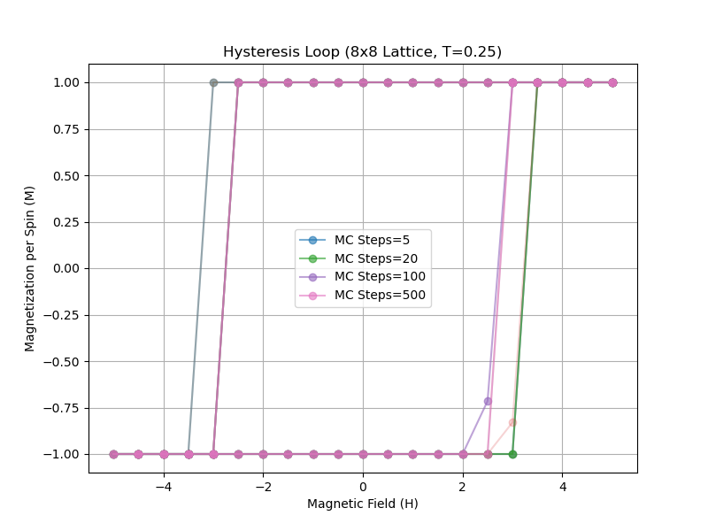
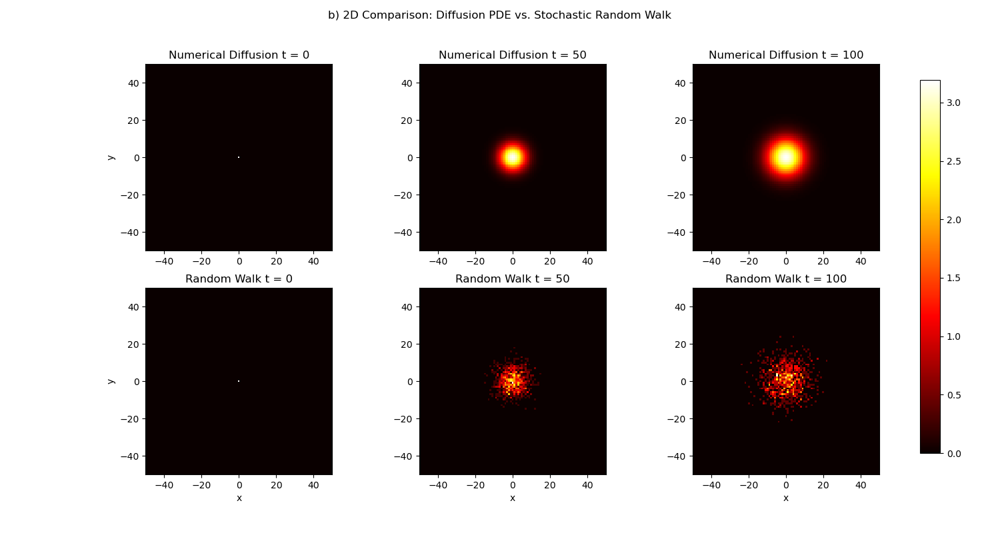
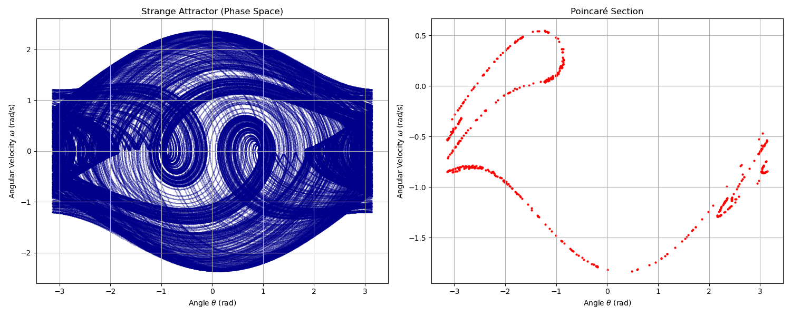

# Numerical Methods & Stochastic Simulations in Python

Implementation of numerical algorithms for stochastic simulation, partial differential equations (PDEs), and non-linear dynamical systems developed during my B.Sc. in Physics coursework at Universidad Autónoma de Madrid (UAM).

---

## Repository Structure

### 1. Stochastic Simulation & Monte Carlo (`01-monte-carlo-stochastic/`)
* **`ising_2d_hysteresis_monte_carlo.py`**: 2D Ising model simulation using the **Metropolis algorithm** with periodic boundary conditions. Analyzes ferromagnetic phase transitions, magnetic hysteresis loops across temperature regimes, relaxation times, and dissipated energy via trapezoidal numerical integration.
* **`random_walk_diffusion_entropy_2d.py`**: Simulates an ensemble of 2D isotropic random walkers, verifies diffusive variance scaling ($\langle r^2 \rangle = 4Dt$), solves the macroscopic 2D diffusion PDE via **explicit FTCS finite differences**, and tracks coarse-grained Shannon entropy $S(t)$.

### 2. PDE Finite-Difference Solvers (`02-pde-finite-differences/`)
* **`laplace_cylindrical_gauss_seidel.py`**: Solves the 1D and 2D Laplace boundary-value problem in cylindrical coordinates using **Gauss-Seidel iterative relaxation**, benchmarks numerical convergence against exact analytical solutions, and computes the electric field $\vec{E} = -\nabla V$ via numerical gradients.

### 3. ODE Integration & Non-Linear Dynamics (`03-ode-dynamical-systems/`)
* **`chaotic_pendulum_lyapunov_poincare.py`**: Integrates a driven damped pendulum via the semi-implicit **Euler-Cromer scheme**, estimates the maximal **Lyapunov exponent** via linear regression of trajectory divergence, and reconstructs the strange attractor alongside its Poincaré section.
* **`halleys_comet_3d_precession.py`**: 3D two-body and restricted three-body (Sun–Jupiter–Comet) orbital integration using the symplectic **Euler-Cromer method**, verifying energy/angular momentum conservation and measuring aphelion precession.
* **`magnus_effect_3d_trajectory.py`**: Coupled 3D ODE solver (**Forward Euler**) modeling projectile trajectories under gravity, quadratic aerodynamic drag, and Magnus spin forces.

---

## Sample Results

| 2D Ising Magnetic Hysteresis | Diffusion PDE vs. Random Walk | Strange Attractor & Poincaré Section |
| :---: | :---: | :---: |
|  |  |  |

---

## Requirements & Execution

Install the required scientific libraries:
```bash
pip install -r requirements.txt
```

Run any script independently:
```bash
python 01-monte-carlo-stochastic/ising_2d_hysteresis_monte_carlo.py
```
